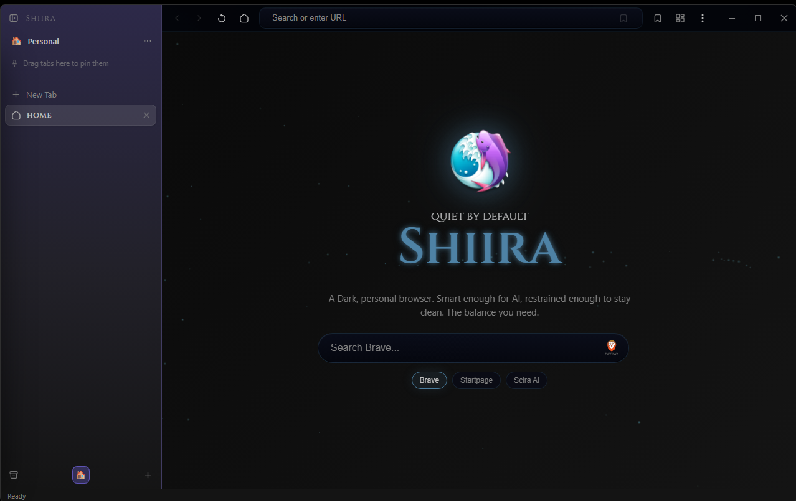

[Read a review of Shiira Browser](https://www.byearc.workers.dev/browsers/shiira/)

<div align="center">

  

  # Shiira Browser

  ### A calm, capable browser for the way you actually browse.

  A modern Electron homage to the classic Shiira browser for Mac OS X — with a dark, customizable interface, powerful tab workflows, and practical privacy tools.

  <p>
    <a href="https://github.com/skonester/Shiira/releases"><strong>Download</strong></a>
    ·
    <a href="https://github.com/skonester/Shiira/issues">Report a bug</a>
    ·
    <a href="https://github.com/skonester/Shiira/discussions">Join the discussion</a>
  </p>

  <p>
    <a href="https://github.com/skonester/Shiira/releases"></a>
    <a href="https://github.com/skonester/Shiira/blob/main/LICENSE"></a>
    <a href="https://github.com/skonester/Shiira/stargazers"></a>
    <a href="https://github.com/skonester/Shiira/issues"></a>
    <a href="https://www.electronjs.org/"></a>
  </p>

  

</div>

> [!NOTE]
> Shiira is in active development and is best used as a secondary browser while the project matures. Please report bugs and unexpected behavior with your operating system, Shiira version, and reproduction steps.

## At a glance

| | |
| --- | --- |
| **Engine** | Chromium 156 via Castlabs Electron 45 ([runtime maintenance](docs/runtime.md)) |
| **Release** | `0.4.0` |
| **Platforms** | Windows · macOS · Linux |
| **License** | GPL-3.0-only |
| **Best for** | Tab-heavy workflows, customization, and focused browsing |

## Why Shiira?

Shiira is built for people who want a browser that feels like *their* workspace. It pairs a focused dark interface with the browser features you depend on every day, without turning the window into a dashboard.

|  |  |
| --- | --- |
| **Organize your attention** | Spaces, favorites, pinned tabs, folders, split view, Peek, and an archive for tabs you have not used recently. |
| **Make it yours** | Shiira Night, themes, a custom color wheel, flexible sidebar/top-tab layouts, and configurable startup behavior. |
| **Browse with confidence** | Native ad blocking, cosmetic filtering, private tabs, site-permission controls, cache tools, and secure password storage. |
| **Keep your workflow moving** | Command bar, Tab Expose, Chrome extension support, Arc import, bookmarks, history, RSS, and session restore. |

## Feature highlights

### A better way to manage tabs

- **Spaces** keep separate projects in their own tab sets, names, emoji, and colors.
- **Profiles per Space** separate website logins, storage, permissions, history, favorites and extensions. Create or rename a profile in the Space editor. Existing data stays in Default.
- **Live sidebar updates** share Spaces, pinned tabs, folders, favorites and the archive between windows, merging independent edits while each window keeps its active page.
- **Favorites, pinned tabs, and folders** stay available across restarts.
- **Today tabs** automatically move inactive tabs to the Archive.
- **Split view** places up to four pages in columns, stacked rows or a grid, while **Peek** previews links without interrupting the page you are reading.
- **Tab sleep** releases memory from tabs you are not using and reloads them when needed.
- **Tab Expose** gives you a visual overview of every open tab.

### Practical browser tools

- **Browser bookmark import** from Chrome, Edge, Brave, Vivaldi, Opera, Chromium, Firefox, Safari or an HTML export. Preview a source/profile, then choose a new Space, current Space or the bookmarks bar. Pinned bookmarks start asleep. **Arc migration** also brings spaces, nested pinned tabs, all profiles' favorites, optional Today tabs and history, archived tabs, and cached icons into Shiira's Default profile; assign different profiles to imported Spaces afterwards.
- **Recent-tab switcher** with Ctrl+Tab, clean link and Markdown copying, Space export, area/full-page capture, per-site CSS **Boosts and Zap**, localhost developer mode, automatic picture-in-picture and sidebar media controls. See the [Orbe port comparison and remaining gaps](docs/orbe-feature-port.md).
- **Little Shiira** opens quick pages with Ctrl/Cmd+Alt+N and promotes them into a chosen Space. **Link Routing** sends links from other apps to a Space or Little window. **Settings → Keyboard Shortcuts** records custom bindings, resolves browser-command conflicts and resets defaults.
- **Notes and Easels** open from the pen button or command bar. Write formatted notes and checklists, or arrange text, drawings, shapes, images and page captures on a canvas. Documents autosave locally by profile, preserve concurrent edits through Save as copy, and export to text or PNG.
- **Tab to Search** in the command bar: type a site such as `youtube` or `github`, press `Tab`, then enter your query. Search archived tabs too, or use `Shift+Enter` to open a webpage result in split view. Brave, Scira and DuckDuckGo shortcuts use Shiira's internal search tab.
- Manifest V3 **Chrome extensions** from the Chrome Web Store.
- Search inside the home tab with **Brave Search API**, **Scira AI API** (Web, Reddit, X, and People), or **DuckDuckGo Quick** instant answers. Add Brave and Scira keys in **Settings → Search**; keys stay in the operating system keychain. Brave and Scira automatically search their websites in the same tab if their APIs fail. See [search setup](docs/search.md).
- Bookmarks bar, favorites launcher, searchable history, RSS, and session restore.
- Cache, cookies, site storage, downloads, permissions, passwords, and update controls.

### Privacy without ceremony

- Network and cosmetic ad blocking powered by a bundled filtering engine.
- Litube-style direct YouTube playback with adaptive buffering, source recovery, and a built-in YouTube-player fallback. See [YouTube playback](docs/youtube-playback.md).
- Private tabs that keep extensions disabled.
- Optional clear-on-exit cache behavior and straightforward browsing-data controls.
- Password storage backed by the operating system keychain.

Password Anvil and the bookmarks bar are app-wide tools. Vault autofill is enabled only in Default; other profiles do not receive its credentials automatically. Notes, Easels and shared sidebars are local to this installation, with no cloud account or cross-device sync.

## Latest release — `0.4.0`

- YouTube media requests retain Litube-style pre-roll availability deadlines, adaptive query ranges, and same-source POST compatibility after a refused GET. Shaka retries temporary failures before source recovery.
- Pre-roll handling includes modern ad slots and forecasting ads with unknown duration. Buffering alone no longer unloads the player. Equal challenges share evaluation, and VOD HLS path challenges are resolved.
- The separate WEB_SAFARI route preserves its request/media identity. Playback confirmation requires a decoded frame from Shiira's player; local diagnostics identify extraction, transport and player failures.
- YouTube player DOM rebuilds retain the loaded stream. Terminal failures show a retry choice; native YouTube playback requires selecting its button.
- Startup enables persistent V8 compilation caching before loading the main application, covering CommonJS and ES modules.
- A lightweight splash uses the bundled Shiira logo while the browser prepares its initial tab.
- The UI preload sets the home screen's dark canvas before renderer initialization. Remote fonts wait until initial readiness, and the splash timeout waits for first paint.
- Graphics selection uses Chromium's platform defaults and driver restrictions instead of forcing Vulkan on every operating system.

Live playback, splash appearance and startup timing still need verification in the packaged application.
The [Litube playback audit](docs/litube-playback-audit.md) records the remaining gaps in the adaptation.

## Previous release — `0.3.9`

Version 0.3.9 brings a major browser-engine upgrade, fixes YouTube Shorts compatibility, and updates clipboard handling, password-storage dependencies, packaging, and release checks.

> [!IMPORTANT]
> **Scira API key support is still under investigation.** This release does not resolve the Scira API integration issue. Scira website searches remain available, with Web, Reddit and X source selection preserved. When an API request fails or no key is configured, Shiira opens Scira's website in the same tab.

<details>
<summary><strong>See what changed</strong></summary>

- **Browser-engine upgrade:** moved from Castlabs Electron `39.0.0+wvcus` / Chromium `142.0.7444.52` to Castlabs Electron `45.2.1+wvcus` / Chromium `156.0.8078.75`, with embedded Node.js `24.22.1`. The application and packaged builds use the same pinned Castlabs runtime. See [runtime maintenance](docs/runtime.md) for the update policy and Castlabs' release cadence.
- **Native YouTube Shorts playback:** disabled Shiira's built-in ad blocking and Litube stream replacement on `/shorts` pages by default, so Shorts uses YouTube's own player and scrolling feed.
- **Navigation between Shorts and watch videos:** entering Shorts releases the replacement player and its pending media work, including when switching to the same video without a page reload. Returning to a regular watch page restores filtering and Litube playback. Direct Shorts loads receive the same exception. See [YouTube playback](docs/youtube-playback.md).
- **Clipboard compatibility:** updated Copy image for Electron's asynchronous clipboard API, covering both image URLs and image data. Failed clipboard writes report an error instead of being treated as successful copies.
- **Password-storage compatibility:** upgraded `better-sqlite3` to `13.1.1` and verified encrypted password creation, updates and deletion with the new runtime. SQLite and keytar use Node-API binaries, avoiding a rebuild for each Electron ABI.
- **Widevine initialization:** restored explicit component initialization in the background, allowing the browser to open while Widevine installs or updates. Production streaming-service compatibility still depends on signing and provider requirements.
- **Packaging and clean installs:** upgraded electron-builder to `26.18.0`, updated the sandboxed preload target for Chromium 156, explicitly unpacked native libraries, and added a lockfile workaround for npm's unnecessary SQLite compilation. The release workflow explicitly downloads the Castlabs runtime before building.
- **Automated release checks:** added unit tests to the release workflow and a Windows runtime check before publishing. Expanded coverage includes encrypted SQLite storage, image clipboard handling, a local Manifest V3 extension, Shorts filtering exceptions, native playback, and transitions back to regular videos.

Local verification passed **103 unit tests**, the YouTube playback and Shorts checks against both source and packaged Windows code, and Windows installer/portable builds. The broader Electron smoke suites also cover Arc import, search, settings persistence and Scira website source selection; these fixture checks do not establish that live Scira API key access is working.

</details>

## Download and run

### Download a release

Visit the **[Releases](https://github.com/skonester/Shiira/releases)** page to download the latest installer or portable build.

| Platform | Available builds |
| --- | --- |
| Windows | Installer and portable executable |
| macOS | DMG |
| Linux | AppImage and DEB |

> [!WARNING]
> Development builds may change behavior or browser-data formats. Back up important browser data before testing unreleased builds.

### Run from source

Use Node.js 22.12.0 or newer. The `.nvmrc` file selects Node 22, matching the release workflow.

```bash
git clone https://github.com/skonester/Shiira.git
cd Shiira
npm install
npm run dev
```

The development command starts Electron with logging enabled. To run the packaged application directly:

```bash
npm start
```

## Keyboard shortcuts

| Shortcut | Action |
| --- | --- |
| `Ctrl+T` | Open the command bar or a new tab |
| `Ctrl+W` | Close or unload the current tab |
| `Ctrl+S` | Show or hide the sidebar |
| `Ctrl+D` | Pin or unpin the current tab |
| `Ctrl+Shift+\` | Split view with the next tab |
| `Ctrl+Shift+A` | Open archived tabs |
| `Ctrl+Shift+N` | Open a private tab |
| `Ctrl+Shift+E` | Open Tab Expose |
| `Ctrl+L` | Focus the URL bar |
| `Ctrl+H` | Open history |
| `Ctrl+,` | Open settings |
| `Ctrl+Tab` / `Ctrl+Shift+Tab` | Next / previous tab |
| `Alt+1` … `Alt+9` | Switch to a space |
| `Shift` + click a link | Open Peek |

<details>
<summary><strong>More shortcuts</strong></summary>

| Shortcut | Action |
| --- | --- |
| `Ctrl+Shift+C` | Copy page address |
| `Ctrl+Shift+T` | Reopen closed tab |
| `Ctrl+Shift+B` | Toggle bookmarks bar |
| `Ctrl+Shift+I` | Open developer tools |
| `Ctrl+Alt+Left` / `Ctrl+Alt+Right` | Previous / next space |
| `Ctrl+R` / `F5` | Reload |
| `Ctrl+Shift+R` | Hard reload |
| `Alt+Left` / `Alt+Right` | Back / forward |
| `Escape` | Close popups and panels |

</details>

## Build

```bash
npm run build
```

For a platform-specific package:

```bash
npm run build:win
npm run build:mac
npm run build:linux
```

Build artifacts are written to `dist/`.

## How it works

Shiira is a desktop browser built around Electron and Chromium:

- **Main process** handles windows, tabs, downloads, updates, browser services, filtering, and persistence.
- **Preload bridge** exposes a constrained IPC API to the renderer.
- **Renderer** provides the browser chrome, sidebar, palettes, settings, and tab workflow.
- **Filter lists and assets** ship with the application and support the browser’s ad-blocking and visual identity.

## Project structure

```text
src/main/                 Main Electron process and browser services
src/preload/              Secure IPC bridge
src/renderer/             Browser UI
src/renderer/modules/     Browser feature modules
assets/                   App artwork, UI icons, and site logos
filter-lists/             Ad-blocking rules
build/                    Build hooks and installer assets
installer/                Installer UI
```

## Status and roadmap

See the [Arc/YARC feature comparison](docs/arc-feature-comparison.md) for migration details and remaining gaps, including isolated profiles, Little Arc, multiwindow workspace sharing, and advanced split layouts.

Shiira is usable today as a secondary desktop browser and is still evolving. The classic Shiira-inspired feature set is being rebuilt incrementally around the modern sidebar workflow.

**Implemented:** tabbed windows, bookmarks, history, palettes, bookmarks bar, themes, favicons, cache controls, session restore, ad blocking, spaces, extensions, split view, Peek, tab sleep, Arc import, and password storage.

**Still planned:** Safari bookmark sharing, toolbar customization, per-bookmark favicon controls, a full help document, source/header inspection, wheel-button tab actions, and bookmark-folder auto-tabs.

## Contributing

Bug reports, feature ideas, and pull requests are welcome. Before opening an issue, please search existing issues and include your operating system, Shiira version, steps to reproduce, and relevant logs or screenshots.

- **[Open an issue](https://github.com/skonester/Shiira/issues/new/choose)**
- **[Browse discussions](https://github.com/skonester/Shiira/discussions)**
- **[Read the credits and attributions](credits.md)**

For code changes, start with a focused issue or pull request description and include screenshots when changing browser chrome or user-facing behavior. Run the test suite before submitting:

```bash
npm test
```

## License

Shiira Browser is licensed under **[GPL-3.0-only](LICENSE)**.

This project is an independent Electron implementation and homage to the classic Shiira browser. It does not include original Shiira source code. For copyright attributions and dependency licensing details, see [credits.md](credits.md) and [`THIRD_PARTY_NOTICES/`](THIRD_PARTY_NOTICES/).

<div align="center">

  <sub>Built with curiosity, Chromium, and a fondness for beautiful browser chrome.</sub>

</div>
