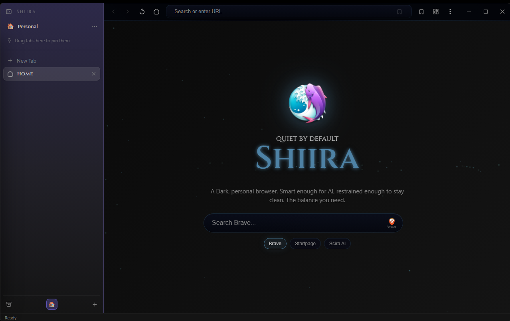

<div align="center">

  

  # Shiira Browser

  ### A calm, capable browser for the way you actually browse.

  A modern Electron homage to the classic Shiira browser for Mac OS X — with a dark, customizable interface, powerful tab workflows, and practical privacy tools.

  <p>
    <a href="https://github.com/skonester/Shiira/releases"><strong>Download</strong></a>
    ·
    <a href="https://github.com/skonester/Shiira/issues">Report a bug</a>
    ·
    <a href="https://github.com/skonester/Shiira/discussions">Join the discussion</a>
  </p>

  <p>
    <a href="https://github.com/skonester/Shiira/releases"></a>
    <a href="https://github.com/skonester/Shiira/blob/main/LICENSE"></a>
    <a href="https://github.com/skonester/Shiira/stargazers"></a>
    <a href="https://github.com/skonester/Shiira/issues"></a>
    <a href="https://www.electronjs.org/"></a>
  </p>

  

</div>

> [!NOTE]
> Shiira is in active development and is best used as a secondary browser while the project matures. Please report bugs and unexpected behavior with your operating system, Shiira version, and reproduction steps.

## At a glance

| | |
| --- | --- |
| **Engine** | Chromium via Electron |
| **Release** | `0.3.5` |
| **Platforms** | Windows · macOS · Linux |
| **License** | GPL-3.0-only |
| **Best for** | Tab-heavy workflows, customization, and focused browsing |

## Why Shiira?

Shiira is built for people who want a browser that feels like *their* workspace. It pairs a focused dark interface with the browser features you depend on every day, without turning the window into a dashboard.

|  |  |
| --- | --- |
| **Organize your attention** | Spaces, favorites, pinned tabs, folders, split view, Peek, and an archive for tabs you have not used recently. |
| **Make it yours** | Shiira Night, themes, a custom color wheel, flexible sidebar/top-tab layouts, and configurable startup behavior. |
| **Browse with confidence** | Native ad blocking, cosmetic filtering, private tabs, site-permission controls, cache tools, and secure password storage. |
| **Keep your workflow moving** | Command bar, Tab Expose, Chrome extension support, Arc import, bookmarks, history, RSS, and session restore. |

## Feature highlights

### A better way to manage tabs

- **Spaces** keep separate projects in their own tab sets, names, emoji, and colors.
- **Favorites, pinned tabs, and folders** stay available across restarts.
- **Today tabs** automatically move inactive tabs to the Archive.
- **Split view** places two tabs side by side, while **Peek** previews links without interrupting the page you are reading.
- **Tab sleep** releases memory from tabs you are not using and reloads them when needed.
- **Tab Expose** gives you a visual overview of every open tab.

### Practical browser tools

- Chrome bookmark import and **Arc migration** from a local installation or copied Arc folder: spaces, nested pinned tabs, all profiles' favorites, optional Today tabs and history, archived tabs, and cached icons. Favorites and history merge into Shiira's shared browsing session.
- **Tab to Search** in the command bar: type a site such as `youtube` or `github`, press `Tab`, then enter your query. Search archived tabs too, or use `Shift+Enter` to open a webpage result in split view. Brave, Scira and DuckDuckGo shortcuts use Shiira's internal search tab.
- Manifest V3 **Chrome extensions** from the Chrome Web Store.
- Search inside the home tab with **Brave Search API**, **Scira AI API** (Web, Reddit, X, and People), or **DuckDuckGo Quick** instant answers. Add Brave and Scira keys in **Settings → Search**; keys stay in the operating system keychain. See [search setup](docs/search.md).
- Bookmarks bar, favorites launcher, searchable history, RSS, and session restore.
- Cache, cookies, site storage, downloads, permissions, passwords, and update controls.

### Privacy without ceremony

- Network and cosmetic ad blocking powered by a bundled filtering engine.
- Compatibility-safe filtering for YouTube and video-heavy sites.
- Private tabs that keep extensions disabled.
- Optional clear-on-exit cache behavior and straightforward browsing-data controls.
- Password storage backed by the operating system keychain.

## Latest release — `0.3.5`

The current release adds the Arc-style vertical sidebar and Chrome extension support, while keeping the classic top tab bar available in **Settings → Look and Feel**.

<details>
<summary><strong>See what changed</strong></summary>

- Spaces with independent names, emoji, colors, and tab sets.
- Shared favorites, pinned tabs, folders, and archived Today tabs.
- Command bar (`Ctrl+T`) for opening sites, searching, and jumping between tabs or spaces.
- Split view, Peek, tab sleep, and Arc import.
- Chrome Web Store extensions with capability previews and private-tab protection.
- A more reliable Ghostery-powered ad-blocking session and one-time-per-page blocking scripts.

</details>

## Download and run

### Download a release

Visit the **[Releases](https://github.com/skonester/Shiira/releases)** page to download the latest installer or portable build.

| Platform | Available builds |
| --- | --- |
| Windows | Installer and portable executable |
| macOS | DMG |
| Linux | AppImage and DEB |

> [!WARNING]
> Development builds may change behavior or browser-data formats. Back up important browser data before testing unreleased builds.

### Run from source

```bash
git clone https://github.com/skonester/Shiira.git
cd Shiira
npm install
npm run dev
```

The development command starts Electron with logging enabled. To run the packaged application directly:

```bash
npm start
```

## Keyboard shortcuts

| Shortcut | Action |
| --- | --- |
| `Ctrl+T` | Open the command bar or a new tab |
| `Ctrl+W` | Close or unload the current tab |
| `Ctrl+S` | Show or hide the sidebar |
| `Ctrl+D` | Pin or unpin the current tab |
| `Ctrl+Shift+\` | Split view with the next tab |
| `Ctrl+Shift+A` | Open archived tabs |
| `Ctrl+Shift+N` | Open a private tab |
| `Ctrl+Shift+E` | Open Tab Expose |
| `Ctrl+L` | Focus the URL bar |
| `Ctrl+H` | Open history |
| `Ctrl+,` | Open settings |
| `Ctrl+Tab` / `Ctrl+Shift+Tab` | Next / previous tab |
| `Alt+1` … `Alt+9` | Switch to a space |
| `Shift` + click a link | Open Peek |

<details>
<summary><strong>More shortcuts</strong></summary>

| Shortcut | Action |
| --- | --- |
| `Ctrl+Shift+C` | Copy page address |
| `Ctrl+Shift+T` | Reopen closed tab |
| `Ctrl+Shift+B` | Toggle bookmarks bar |
| `Ctrl+Shift+I` | Open developer tools |
| `Ctrl+Alt+Left` / `Ctrl+Alt+Right` | Previous / next space |
| `Ctrl+R` / `F5` | Reload |
| `Ctrl+Shift+R` | Hard reload |
| `Alt+Left` / `Alt+Right` | Back / forward |
| `Escape` | Close popups and panels |

</details>

## Build

```bash
npm run build
```

For a platform-specific package:

```bash
npm run build:win
npm run build:mac
npm run build:linux
```

Build artifacts are written to `dist/`.

## How it works

Shiira is a desktop browser built around Electron and Chromium:

- **Main process** handles windows, tabs, downloads, updates, browser services, filtering, and persistence.
- **Preload bridge** exposes a constrained IPC API to the renderer.
- **Renderer** provides the browser chrome, sidebar, palettes, settings, and tab workflow.
- **Filter lists and assets** ship with the application and support the browser’s ad-blocking and visual identity.

## Project structure

```text
src/main/                 Main Electron process and browser services
src/preload/              Secure IPC bridge
src/renderer/             Browser UI
src/renderer/modules/     Browser feature modules
assets/                   App artwork, UI icons, and site logos
filter-lists/             Ad-blocking rules
build/                    Build hooks and installer assets
installer/                Installer UI
```

## Status and roadmap

See the [Arc/YARC feature comparison](docs/arc-feature-comparison.md) for migration details and remaining gaps, including isolated profiles, Little Arc, multiwindow workspace sharing, and advanced split layouts.

Shiira is usable today as a secondary desktop browser and is still evolving. The classic Shiira-inspired feature set is being rebuilt incrementally around the modern sidebar workflow.

**Implemented:** tabbed windows, bookmarks, history, palettes, bookmarks bar, themes, favicons, cache controls, session restore, ad blocking, spaces, extensions, split view, Peek, tab sleep, Arc import, and password storage.

**Still planned:** Safari bookmark sharing, toolbar customization, per-bookmark favicon controls, a full help document, source/header inspection, wheel-button tab actions, and bookmark-folder auto-tabs.

## Contributing

Bug reports, feature ideas, and pull requests are welcome. Before opening an issue, please search existing issues and include your operating system, Shiira version, steps to reproduce, and relevant logs or screenshots.

- **[Open an issue](https://github.com/skonester/Shiira/issues/new/choose)**
- **[Browse discussions](https://github.com/skonester/Shiira/discussions)**
- **[Read the credits and attributions](credits.md)**

For code changes, start with a focused issue or pull request description and include screenshots when changing browser chrome or user-facing behavior. Run the test suite before submitting:

```bash
npm test
```

## License

Shiira Browser is licensed under **[GPL-3.0-only](LICENSE)**.

This project is an independent Electron implementation and homage to the classic Shiira browser. It does not include original Shiira source code. For copyright attributions and dependency licensing details, see [credits.md](credits.md) and [`THIRD_PARTY_NOTICES/`](THIRD_PARTY_NOTICES/).

<div align="center">

  <sub>Built with curiosity, Chromium, and a fondness for beautiful browser chrome.</sub>

</div>
